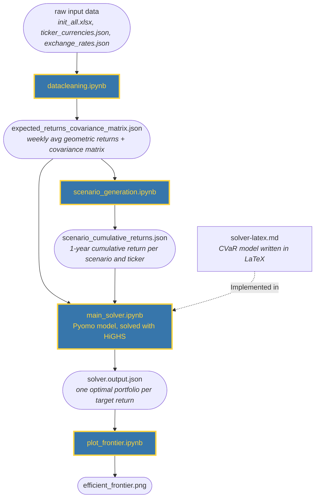
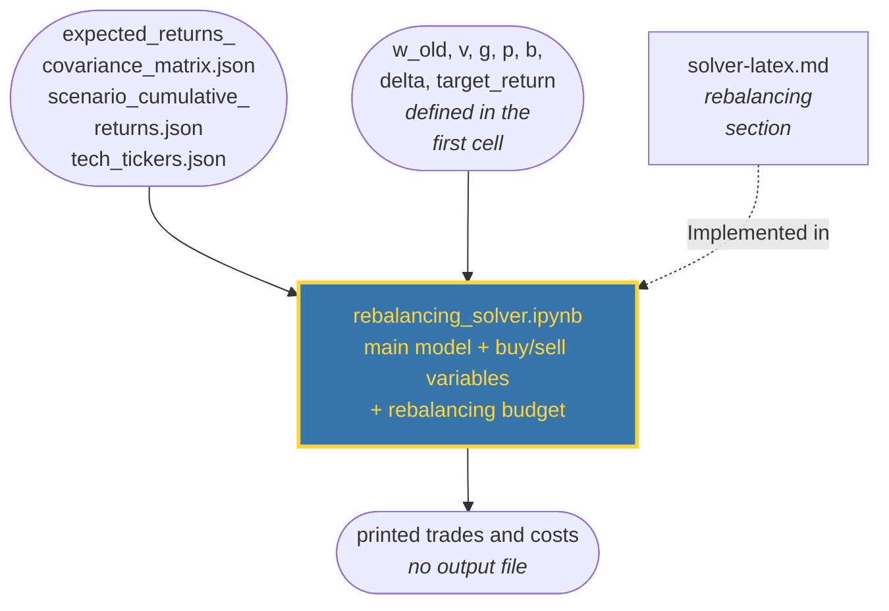

# Main assignment

CVaR portfolio optimization on scenario data. The notebooks live in `src/main_assignment/` and pass data to each other through JSON files in `data/`.

## Architecture

Main solver pipeline. The rebalancing add-on has its own diagram at the end.

## Core logic

1. **Cleaning** (`datacleaning.ipynb`): convert all prices to EUR, drop tickers with missing or negative values, then compute each ticker's average weekly geometric return and the covariance matrix of weekly percentage changes.
2. **Scenarios** (`scenario_generation.ipynb`): for each of 100 scenarios, draw 52 weeks of returns for all tickers from a multivariate normal (mean = expected returns, covariance = the cleaned matrix). Multiplying the 52 weeks gives the one-year growth multiplier per ticker, e.g. `1.02` means +2%.
3. **Solver** (`main_solver.ipynb`): `solve_cvar` minimizes CVaR at `alpha = 0.95` (model in `solver-latex.md`).
   - The weights sum to 1, and the portfolio's expected return must land within a small band (`±tolerance`) around the target return.
   - The expected returns are annualized (`weekly ** 52`) to match the one-year scenarios.
   - At most `K = 30` stocks are held, enforced with binary variables and a big-M link (`w <= M * x`).
   - At most `J = 30%` of the portfolio may sit in tech stocks (the list is in `data/tech_tickers.json`).
   - The notebook sweeps the target return from `1.0` up to the highest annual expected return. Each target gives one optimal portfolio, and together they trace the frontier. Targets the solver cannot reach (infeasible under the constraints) are printed and left out of the output.
4. **Plot** (`plot_frontier.ipynb`): target return (y) against CVaR (x). Points where the solver hit its time limit are marked.

## Rebalancing (add-on)

An optional extension of the main solver. Everything above works without it.

## Rebalancing logic

`rebalancing_solver.ipynb` holds the main model unchanged (CVaR objective, budget, target return band, cardinality `K`, tech cap `J`) and adds the following. It reads the same input files as the main solver, and `w_old` is defined in its first cell.

- `w_old` is the portfolio held before rebalancing, and `v` is its value in EUR.
- Binary variables `y_buy` / `y_sell` flag the stocks that are traded. The weights `w_buy` / `w_sell` are lower-bounded by the change from `w_old` (`w - w_old` and `w_old - w`).
- Each traded stock costs a fixed fee `g`, plus a proportional cost `p` on the traded value (`v * p * (w_buy + w_sell)`).
- The total cost must stay within the rebalancing budget `b`.
- The objective adds `delta * (fixed + variable costs)` with a tiny `delta = 1e-6`. It only breaks ties, so the buy/sell variables stay as low as possible when the budget is not binding. The returned CVaR excludes this term.
- It runs a single solve at one `target_return` and prints the trades and costs.
