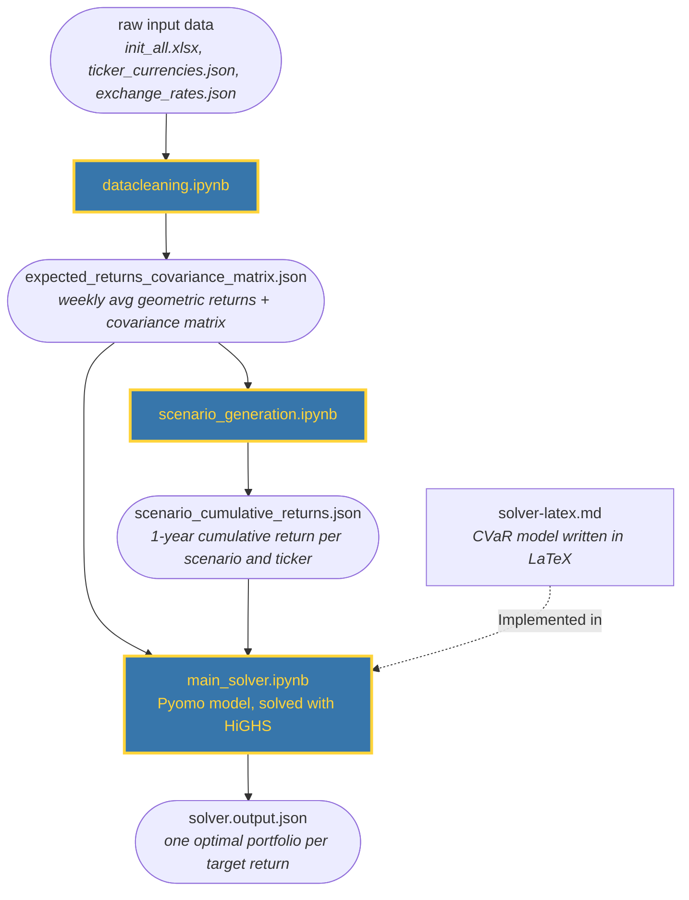

*AI Transparency: We used Claude Code, because LLM based tools can be a powerful companion in code based knowledge work. We were careful to not use it as a substitute for our own thinking

*The report was written with the inital excel database provided*
## Disposition

In this task we build an equity portfolio optimisation framework that minimises the Conditional Value at Risk (CVaR) for a given expected return. We use CVaR because it measures the size of losses in the worst cases directly, which makes the risk easier to interpret and control than variance. The investment strategy is a portfolio with a one-year horizon. Trading in reaction to last week's prices goes against the efficient market hypothesis, and weekly rebalancing amounts to exactly that, so we do not rebalance beyond the free weekly budget. We still use that budget, because it is free and because it lets us show more technical skill.
## Methology

### General architecture

For our IT architecture we had a number of desirable characteristics.
1.  Programmatic approach (facilitates automation)
2. A tool we where familiar with
3. Open Source based 
4. Low complexity

Any IT Architecture is a compromise between different goals. The programmatic approach ruled out excel. When choosing between AMPL and Python, we decided to use Python because it is both open source and would be more beneficial for us in a work context. It is often easier to get access to a Python runtime than an AMPL runtime. The drawback of our approach is that using python packages increases the complexity (environment management is needed), by ruling out commercial solvers we might also be sacrificing some "computational performance", but the effect of this will be negligible for the scope our project.

We used the python package [Pyomo](https://www.pyomo.org/) as the modelling language, and [HIGHS](https://highs.dev/) for the solver.

Choosing the inital portfolio (main solver) and rebalancing the portfolio are two slightly different tasks. Since the re balancing logic can be viewed as an "add-on" to the main solver pipeline we choose to first describe the main solver pipeline
### Main solver pipeline

#### datacleaning.ipynb

We first convert the excel data into a tidy data format (one col per ticker, one row per date). All entries with missing or negative values are dropped

Since our investment is in EUR, we need to manage the fact that some stocks are listed in other currencies. Our concern is with how much our porfolio increased in value measured in EUR. We thus use historical data exchange rates from *exchange_rates.json* to convert all prices into EUR using the exchange rate from exact date the stock price was sampled from. *ticker_currencies.json* details what currency a given ticker was listed with.  
##### computing average geometric returns

We choose to use the geometric growth rate instead of the arithmetic one, because it generally gives more meaningful figures when working with stocks. 

For each ticker, we compute the average geometric growth rate across all the entire time horizon with the following formula:

$$
g = \left(\frac{P_n}{P_0}\right)^{1/n}
$$
##### computing covariance matrix

We first transform our tidy dataset from raw values to pct change, because this is a more interesting metric. We then calculate the covariance matrix using a pandas function, saving us from writing the logic by hand.

At the end of the file we  save our cleaned data to a JSON file.   

#### scenario_generation.ipynb

Since we want to use CVar, we need to generate scenarios. We already have the weekly avg geometric returns and the covariance matrix. We model stock prices as geometric Brownian motion ([Black & Scholes, 1973](https://doi.org/10.1086/260062)), under which returns over a period are normally distributed and independent between periods. This is why we draw the weekly returns from a multivariate normal distribution. With this we use the [scipy.stats.multivariate_normal](https://docs.scipy.org/doc/scipy/reference/generated/scipy.stats.multivariate_normal.html) function to draw samples of returns from the multivariate normal distribution. The draws are made on a weekly level, assuming week $t$ is independent of week $t-1$. We run 100 scenarios with 52 weekly draws in each, giving us 100 scenarios with a time horizon of 1 year. We compute the cumulative returns per ticker per scenario, and store these in *scenario_cumulative_returns.json*

#### main_solver.ipynb

The Latex formulation of the model is described bellow
##### sets

$S$ : set of scenarios  
T : set of tickers (stocks)
$T^{tech} \subset T$ : subset of tickers that are tech stocks
##### decision variables

$\gamma$ : CVar measured in %
$w_t$ : Proportion of portfolio invested into stock $t$ 
$z_s$ : Helper variable for minimizing CVar
$x_t$ : Binary variable, 1 if stock $t$ is in portfolio, 0 otherwise
##### parameter definitons

$\alpha$ : Probability level for CVar (set to 0.95)
$r_{s,t}$ : Return of stock $t$ in scenario $s$ 
$\mu_t$ : Expected yearly (geometric) return of stock $t$
$\mu^*$ : Target portfolio return
$\epsilon$ : Tolerance band around target return (set to 0.000001)
$k$ : Maximum number of stocks in portfolio (set to 30)
$M$ : Big-M constant (set to 1.0) 
$j$ : Maximum share of portfolio in tech stocks (set to 0.3)
##### model formulation
$$
\begin{aligned}
\min_{w,\,z,\,\gamma, ...} \quad & \gamma + \frac{1}{(1-\alpha)|S|} \sum_{s \in S} z_s \quad & &&\text{Minimize CVar}\\
\text{s.t.} \quad & z_s,w_t \ge 0, && s \in S, t \in T \quad & \text{Non-negativity}\\
& \sum_{t \in T} w_t = 1, && & \text{Budget constraint}\\
& \sum_{t \in T} w_t \mu_t \ge \mu^* - \epsilon, && & \text{Target return lower bound}\\
& \sum_{t \in T} w_t \mu_t \le \mu^* + \epsilon, && & \text{Target return upper bound}\\
& z_s \ge 1 - \sum_{t \in T}( w_t r_{s,t}) - \gamma, && s \in S \quad &\text{Loss constraint}\\
& x_t \in \{0, 1\}, && t \in T \quad & \text{Binary domain}\\
& \sum_{t \in T} x_t \le k, && & \text{Cardinality constraint}\\
& w_t \le M \cdot x_t, && t \in T \quad & \text{Big-M linkage} \\
& \sum_{t \in T^{tech}} w_t \le j \quad && & \text{Max share in tech stocks} 
\end{aligned}$$

The objective function and loss constraint is based on Eq 17.10 in the coursebook. The max 30 stocks constraint is held using the big M method, making this problem a MIP problem. HIGHS supports these problems out of the box.

Note that the constraint that the "total portfolio variance must be lower than a portfolio that would invest exactly the same in all asset" is not included in this optimization model. This is because we choose CVar as our risk measure, and adding portfolio variance as a constraint would break linearity. We consider this constraint after we have plotted the efficient frontier.

The tolerance band allows the solver flexibility to find feasible solutions since finding an exact target return is computationally difficult
#### for loop for building efficient frontier

We define a list of target returns to use as constraints. The weekly expected returns from the cleaned input are annualised (weekly ** 52) so they match the one-year scenarios. The minimum of the list is set to 1.0, which means no growth. The maximum is set to the highest annual expected return in the cleaned input, and this value is always included in the list. Between the minimum and the maximum, the list is populated in increments of 0.01. 

For each target return in the list we run a loop that solves the CVaR minimisation model. Each solve has a 10-second time limit. If the solver hits the limit, the best solution found is kept and the result is flagged with its termination condition.

Some of the highest targets cannot be reached under these constraints (this is due to the max proportion in tech stocks). For these targets the solver reports the problem as infeasible. The loop still tries every target in the list. Each failure is printed to the terminal, and failed targets are left out of the output. After the loop, a check confirms that the failed targets form one continuous stretch at the top of the list. If they do not, the run stops with an error, because a gap in the middle would point to a modelling problem rather than a limit on achievable returns.

![[main-assignment/data/efficient_frontier.png]]

The solver solutions show the parabola shape we would expect

#### respecting variance constraint and picking portfolio 

We have the weights of all the solver solutions and the covariance matrix. We can thus easily compute the portfolio variance for each solution, with the standard portfolio variance formula

$$  \sum_{t=1}^{t} \sum_{i=1}^{t} w_t w_i \text{Cov}(r_t, r_i) \\
$$
![[variance_frontier.png]]

We plot the results, with a cutoff for the equall weight portfolio, and then make a decison. From visual inspection of this graph and the CVar graph we see that returns between 16% and 22% are our "available efficient frontier". Which of these points we choose is a subjective tradeoff between CVar and expected returns. We assume that a CVar of 0.066 at a $a$ of 0.95 is deemed acceptable, ie that we are willing to risk loosing on average 6.6% of the value of the portolio in the 5% worst cases. With this risk tolerance we pick the portfolio with an expected return of 22%

Note that the jagged but somewhat parabolic shape is to be expected as CVar and variance correlate (wider bell curves, larger loss tails), but not perfectly so  

### Rebalancing solver pipeline

In the main solver we could pick stocks freely as long as the constraints where kept. In the rebalancing solver we incur costs in EUR by buying or selling. This requires a distinctly different approach.

The model approach here is to modify the existing weights to minimize CVar, while not exceeding a given rebalancing budget. Note that all the variables, parameters and constraints in the main solver are also applied here, the rebalancing solver is thus an expansion of the main solver 

#### model formulation

##### additional variables
 $y_t^{sell}$ : Binary var that must be 1 if stock $t$ is sold
 $y_t^{buy}$ : Binary var that must be 1 if stock $t$ is bought
$w_t^{sell}$ : Variable that must be at least as large as the amount $t$ sold as a proportion of the portfolio
 $w_t^{buy}$ : Variable that must be at least as large as the amount $t$ bought as a proportion of the portfolio

##### additional parameter definitions
$w_t^{old}$ : Proportion of portfolio invested in stock $t$ before current rebalancing
$g$ : Fixed cost of modifying a stock in EUR (set to 10)
$p$ : Proportion cost of transaction (set to 0.0005)
$v$ : The total value of the portfolio before rebalancing
$b$ : The total rebalancing budget in EUR (set to the free budget of 100)
$\delta$ : Small weight on the modification costs in the objective (set to 0.00001)

Note : $w_t^{old}$ cannot be directly inferred from "last weeks" weights, since the prices, and thus the proportions, have changed. Before running the solver both $v$ and $w_t^{old}$ must be calculated. See the appendix for info about this
##### modified objective
The CVaR objective of the main model is replaced by the one below. The extra term only breaks ties: all else equal, it pushes $w_t^{buy}$, $w_t^{sell}$, $y_t^{buy}$ and $y_t^{sell}$ down to the smallest values the constraints allow, instead of leaving them at arbitrary values when the budget is not binding.
$$
\min_{w,\,z,\,\gamma,\,\ldots} \quad \gamma + \frac{1}{(1-\alpha)|S|} \sum_{s \in S} z_s + \delta \left( FixedModCosts + VarModCosts \right)
$$

##### additional constraints
$$
\begin{aligned}
\text{s.t.} \quad & w_t^{buy},w_t^{sell} \ge 0, && t \in T \quad & \text{Non-negativity}\\ 
& y_t^{buy},y_t^{sell}\in \{0, 1\}, && t \in T \quad & \text{Binary domain}\\ 
& y_t^{buy},w_t^{buy} \ge w_t-w_t^{old} && t \in T \quad & \text{Buy var enforcement} \\
& y_t^{sell},w_t^{sell} \ge w_t^{old}-w_t && t \in T \quad & \text{Sell var enforcement} \\
& FixedModCosts =\sum_{t \in T} g ( y_t^{sell} + y_t^{buy})  \\ 
& VarModCosts = \sum_{t \in T} v \cdot p (w_t^{sell} + w_t^{buy}) \\
& FixedModCosts + VarModCosts \le b && & \text{Modification Budget}
\end{aligned} 

$$

## Computational tests

The main solver loop took 20 seconds on a laptop with an i3 processor and 8 GB of ram, this puts the time per solve at bellow one second. No further tests where conducted.

## Appendix

##### Computing $v$ and $w_t^{old}$

At the start of a rebalancing we know the EUR value of each position as it stood last week, and the price changes since then. Let

$a_t$ : Value in EUR of the position in stock $t$ last week
$m_t$ : Price multiplier of stock $t$ since the last week, measured in EUR, ie $m_t = P_t^{now} / P_t^{prev}$

Multiplying each position by its multiplier gives its value before rebalancing. Summing these gives the total value of the portfolio before rebalancing, $v$. Dividing each position by $v$ gives $w_t^{old}$.

$$
\begin{aligned}
v &= \sum_{t \in T} a_t \, m_t \\
w_t^{old} &= \frac{a_t \, m_t}{v}, \qquad t \in T
\end{aligned}
$$

By construction $\sum_{t \in T} w_t^{old} = 1$. After the solver has chosen the new weights, the positions used in the next rebalancing are $a_t = v \cdot w_t$.
